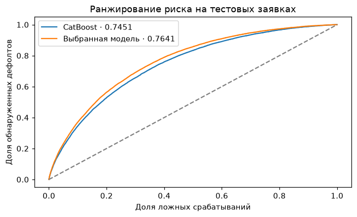

# Прогноз дефолта по кредитной истории

Учебный ML-проект по оценке вероятности дефолта на уровне кредитной заявки. Из 26,16 млн записей о кредитных продуктах собраны истории 3 млн заявок. Итоговый ансамбль объединяет CatBoost на агрегатах и нейросеть, учитывающую порядок продуктов.

**Стек:** Python 3.12 · pandas · PyArrow · scikit-learn · CatBoost · PyTorch · Jupyter.

[Ноутбук](credit_risk.ipynb) · [Результаты экспериментов](RESULTS.md) · [Презентация (PDF)](presentation.pdf)

## Результат

| Метрика на отложенном периоде | Значение |
|---|---:|
| Заявок | 600 000 |
| ROC-AUC · CatBoost | 0,7451 |
| ROC-AUC · ансамбль | **0,7641** |
| Average Precision · ансамбль | 0,1069 |
| Доля дефолтов | 3,32% |

В верхнем дециле по прогнозируемому риску дефолт наблюдался у 11,59% заявок, в нижнем — у 0,33%. Это характеристика ранжирования на изученном периоде.

> **Ограничение оценки.** Отложенный период первоначально использовался для проверки CatBoost, после которой работа над моделями продолжилась. Вес ансамбля подбирался на более ранней валидации. ROC-AUC 0,7641 остаётся исследовательской оценкой и требует подтверждения на новом временном периоде с созревшими метками.



## Методика

- **Разбиение по времени.** Порядок заявок задан идентификатором `id`. Первые 60% использованы для обучения при подборе, следующие 20% — для валидации, последние 20% — для отложенной оценки. Для расчёта отложенных прогнозов модели обучаются на первых 80%.
- **Признаки.** Parquet читается по частям. Внутри заявки продукты упорядочиваются по `rn`. Сравниваются признаки последнего кредита, доли двоичных флагов, частоты категориальных кодов и расширенные агрегаты платёжной истории и риска продуктов. `fclose_flag = 1` обозначает неопределённый фактический срок закрытия кредита.
- **Выбор модели.** На агрегатах сравниваются логистическая регрессия, HistGradientBoosting и конфигурации CatBoost. Отдельная нейросеть обучает представления кодов и учитывает порядок продуктов. На валидации выбраны пять эпох и веса 75% для нейросети и 25% для CatBoost.
- **Пайплайн.** После оценки итоговая модель переобучена на 3 млн заявок. Ноутбук сохраняет её в `credit_pipeline.pkl` и проверяет прогноз после загрузки. В конце ноутбука есть функция для оценки зафиксированной модели на новом периоде.

## Структура

| Файл | Содержание |
|---|---|
| [credit_risk.ipynb](credit_risk.ipynb) | Подготовка данных, эксперименты, обучение и проверка пайплайна |
| [RESULTS.md](RESULTS.md) | Метрики по этапам и ограничения оценки |
| [presentation.pdf](presentation.pdf) | Девять слайдов об итогах проекта |
| [requirements.txt](requirements.txt) | Зависимости для воспроизведения |
| [roc_comparison.png](roc_comparison.png) | ROC-кривые из ноутбука |

## Воспроизведение

Сохранённые агрегированные результаты и графики доступны в ноутбуке без запуска. Для полного расчёта нужны учебные исходники из задания. Разместите рядом с ноутбуком `train_target.csv`, `description.xlsx` и папку `train_data/` с 12 файлами `train_data_*.pq`. В репозиторий входят код и агрегированные результаты. Исходные записи, прогнозы по заявкам, кэши и обученный бинарный файл хранятся локально.

Из корня репозитория под Python 3.12:

```bash
python3.12 -m venv .venv
source .venv/bin/activate
python -m pip install -r requirements.txt
python -m jupyterlab credit_risk.ipynb
```

Выполните ячейки сверху вниз. Полный расчёт требует времени и памяти. Ноутбук переиспользует локальные кэши признаков и промежуточные результаты. Для нового набора данных запускайте расчёт в чистой рабочей папке.
